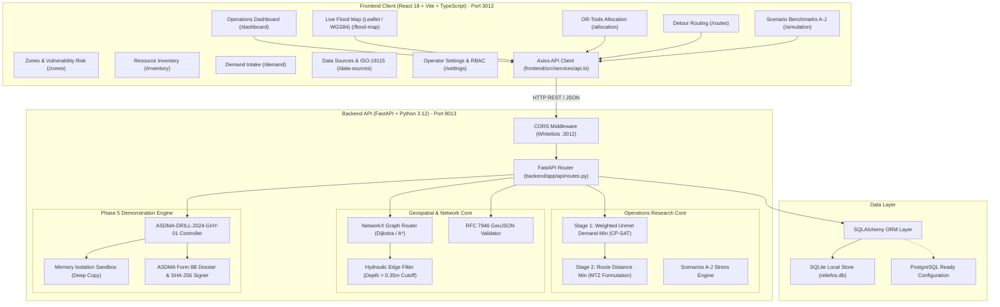
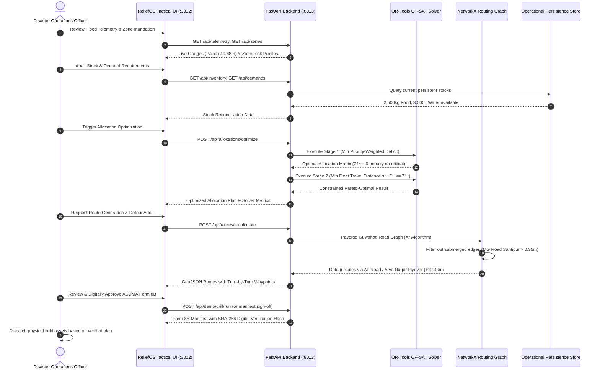

# RELIEFOS Lite — System Architecture & Technical Specification

**Project Focus:** Real-Time Flood Monitoring & Disaster Relief Resource Optimization System  
**Target Region:** Kamrup Metropolitan (Guwahati Urban Agglomeration), Assam, India  
**System Designation:** Academic Capstone Decision-Support System (Human-in-the-Loop)  

---

## 1. System Overview & Architectural Paradigm

RELIEFOS Lite is engineered as a decoupled, two-tier decision-support system designed to assist emergency operations managers (such as Assam State Disaster Management Authority — ASDMA) in allocating constrained relief supplies and computing safe transport routes during severe monsoon inundation events.

### Architectural Core Principles
1. **Decision Support, Not Autonomous Dispatch:** The system formulates mathematical recommendations, vehicle manifests, and routing detours. It enforces a mandatory human officer sign-off before any physical rollout.
2. **Deterministic & Verifiable:** All optimization and simulation routines operate deterministically or with fixed seeds, ensuring identical outputs given identical emergency inputs.
3. **Simulation Data Isolation:** Demonstration drills and stress scenarios run in memory-isolated sandboxes (`copy.deepcopy`), guaranteeing zero mutation to operational database stores.
4. **RFC 7946 Geospatial Integrity:** All geographic layers use standard GeoJSON with EPSG:4326 (WGS84) coordinates, validated against topological ring-closure and coordinate bounding boxes.

---

## 2. Multi-Tier System Topology



---

## 3. Operations Workflow Lifecycle

The end-to-end operational dispatch workflow follows an automated yet strictly reviewed lifecycle:



---

## 4. Mathematical Optimization Model Formulation

The allocation engine implements a rigorous **Two-Stage Lexicographic Optimization Model** formulated in **Google OR-Tools CP-SAT**:

### Mathematical Notation
- $\mathcal{Z}$: Set of operational zones ($i \in \{1, \dots, 5\}$).
- $\mathcal{R}$: Set of relief resource types ($r \in \{\text{food}, \text{water}\}$).
- $\mathcal{V}$: Set of fleet vehicles ($v \in \{1, 2, 3\}$).
- $D_{i,r}$: Demand of resource $r$ at zone $i$ (kg or L).
- $S_r$: Available depot inventory of resource $r$.
- $C_v$: Payload capacity of vehicle $v$ (kg).
- $W_i$: Severity priority weight of zone $i$ (Critical = 10, High = 5, Moderate = 2, Low = 1).
- $x_{i,r}$: Integer decision variable representing allocated quantity of resource $r$ to zone $i$.
- $u_{i,r} = D_{i,r} - x_{i,r}$: Integer slack variable representing unmet demand.

### Stage 1: Priority-Weighted Deficit Minimization
$$\min Z_1 = \sum_{i \in \mathcal{Z}} \sum_{r \in \mathcal{R}} W_i \cdot \alpha_r \cdot (D_{i,r} - x_{i,r})$$
Where $\alpha_{\text{water}} = 1.2$ and $\alpha_{\text{food}} = 1.0$ if life-critical hydration prioritization is active.

**Subject to Constraints:**
1. **Demand Boundedness:** $0 \le x_{i,r} \le D_{i,r}, \quad \forall i \in \mathcal{Z}, r \in \mathcal{R}$
2. **Depot Inventory Limits:** $\sum_{i \in \mathcal{Z}} x_{i,r} \le S_r, \quad \forall r \in \mathcal{R}$
3. **Fleet Single-Wave Capacity:** $\sum_{i \in \mathcal{Z}} \sum_{r \in \mathcal{R}} x_{i,r} \le \sum_{v \in \mathcal{V}} C_v$
4. **Resource Non-Substitution:** Separate constraint rows for food (kg) and water (L). Food stock cannot satisfy water deficit.

### Stage 2: Travel Distance Minimization with Bounded Deficit
Let $Z_1^*$ be the proven optimal objective value obtained from Stage 1:
$$\min Z_2 = \sum_{v \in \mathcal{V}} \sum_{j \in \mathcal{N}} \sum_{k \in \mathcal{N}} d_{j,k} \cdot y_{j,k,v}$$
**Subject to:**
1. **Lexicographic Preservation:**
   $$\sum_{i \in \mathcal{Z}} \sum_{r \in \mathcal{R}} W_i \cdot \alpha_r \cdot (D_{i,r} - x_{i,r}) \le Z_1^*$$
   *(Guarantees that routing efficiency never compromises life-saving relief fulfillment)*.
2. **Vehicle Flow & Depot Round-Trip:** Every vehicle $v$ must depart from and return to Depot 0 (Sarusajai).
3. **Subtour Elimination (MTZ Formulation):**
   $$u_j - u_k + |\mathcal{Z}| \cdot y_{j,k,v} \le |\mathcal{Z}| - 1, \quad \forall j \ne k > 0$$

---

## 5. Topological Routing & Hydrological Detours

The routing engine represents Guwahati's road infrastructure as a directed weighted graph $G = (V, E)$ using **NetworkX**:
- **Nodes ($V$):** Geographic coordinates of intersections, depots, and shelter waypoints.
- **Edges ($E$):** Road segments with properties: `length_km`, `road_type`, `clearance_height_m`, `water_depth_m`.

### Inundation Edge Cutoff Criterion
For any edge $e = (u, v) \in E$:
$$\text{Weight}(e) = \begin{cases} 
\text{length\_km}(e) & \text{if } \text{water\_depth\_m}(e) \le 0.35 \\
\infty & \text{if } \text{water\_depth\_m}(e) > 0.35 \text{ (Impassable)}
\end{cases}$$

### Verified Detour Behavior:
- **Submerged Edge:** MG Road Santipur Culvert Section ($\text{water\_depth} = 0.40\,\text{m} > 0.35\,\text{m}$).
- **Automated Routing Reaction:** The router prunes edge `(Bharalumukh, MG_Road_Santipur)` and calculates the shortest safe path via the elevated AT Road Arterial / Arya Nagar Flyover corridor (+12.4 km additional detour distance).
- **Isolated Node Handling:** If a zone's cut-set is completely flooded (e.g. Scenario H), Dijkstra returns `nx.NetworkXNoPath`. The system assigns 0 kg road allocation and raises a high-priority `"TOPOLOGICAL_SEVERANCE"` alert recommending amphibious boat or helicopter airlift.

---

## 6. Demonstration Mode & Simulation Sandbox

To permit realistic operator training without corrupting operational records, the Phase 5 Demonstration Service enforces strict isolation:

```
[Operational Database (SQLite / Postgres)]
       │ (Read Baseline Only)
       ▼
 [copy.deepcopy()]
       │
       ▼
[Demonstration Sandbox Memory]
       ├── Scenario Metadata: ASDMA-DRILL-2024-GHY-01
       ├── Hydrometric Telemetry: Pandu Gauge 49.68m
       ├── Isolated Demand Grid (7,100 kg total)
       ├── Single-Wave Fleet Capacity (5,000 kg)
       └── CP-SAT Solver Execution & Detour Manifests
       │
       ▼
[JSON Audit Dossier Export with SHA-256 Signature]
```

### Reset Guarantee
Calling `POST /api/demo/drill/reset` purges the in-memory drill session and returns the UI state directly to the unmutated operational baseline.

---

## 7. Port Reference & Development Services

| Service | Host | Port | Runtime | Purpose |
| :--- | :--- | :--- | :--- | :--- |
| **Frontend UI** | `localhost` | **3012** | Node.js / Vite 5 / React 18 | GIS Command Center, 10 Pages |
| **Backend API** | `127.0.0.1` | **8013** | Python 3.12 / Uvicorn | FastAPI REST API, Solvers, GIS Services |
| **OpenAPI Docs** | `127.0.0.1` | **8013** | Swagger UI | `/docs` Interactive Documentation |
| **ReDoc** | `127.0.0.1` | **8013** | ReDoc Engine | `/redoc` Formal Academic Spec |
